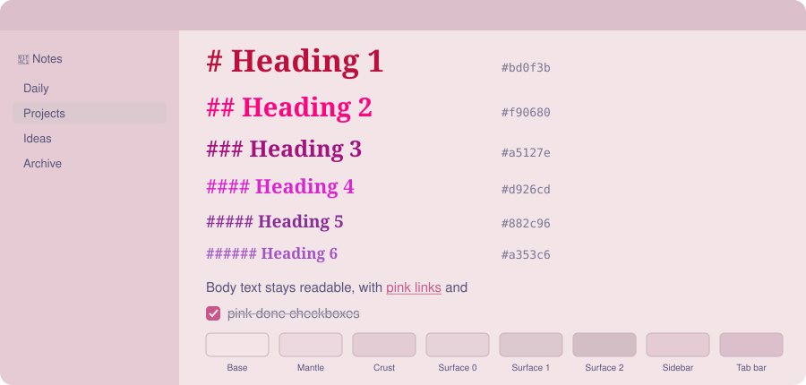

# 🌸 AnuPpuccin Pink

A pink light mode for [Obsidian](https://obsidian.md) built **on top of** the [AnuPpuccin](https://github.com/AnubisNekhet/AnuPpuccin) theme's Rosé Pine flavor. It isn't a new theme. It's a small Style Settings preset plus one CSS snippet.

*Mockup of the palette, not a screenshot.*

## 🎯 Intent

- 🌸 **Pink wherever it reads as frame or structure**: accent, links, backgrounds, sidebars, headings, note title, done checkboxes.
- 🧭 **Headings stay navigable**: each level gets its own distinct pink, so you can tell H1 from H4 at a glance.
- 📖 **Body text stays readable**: paragraphs and bold keep the theme's dark text color.
- 🚦 **Signals keep their meaning**: `!` priority tasks stay yellow/orange and cancelled tasks stay red-pink.
- ☀️ **Light mode is the pink mode**: dark mode (Mocha) only gets a pink accent.

## 📦 Install

Requires Obsidian 1.6+.

1. **Theme**: Settings → Appearance → Themes → install and use **AnuPpuccin**.
2. **Plugin**: Settings → Community plugins → install and enable **Style Settings**.
3. **Preset**: Settings → Style Settings → **Import** (top of the page) → paste the contents of [`style-settings.json`](style-settings.json) → Save.
   Import only adds or overwrites these keys; your other Style Settings stay as they are.
4. **Snippet**: copy [`snippets/pink-accents.css`](snippets/pink-accents.css) into `<your vault>/.obsidian/snippets/`, then Settings → Appearance → CSS snippets → reload → enable `pink-accents`.
5. Switch Obsidian to the light base color scheme.

## 🎨 Palette

### Accent

| Role | Hex | Notes |
|---|---|---|
| Accent, links, done `[x]` checkbox (light) | `#c6588a` | Replaces Rosé Pine's "Pink" slot |
| Accent (dark) | `#f5c2e7` | Mocha's own pink |

> [!WARNING]
> In AnuPpuccin's Rosé Pine palette, the slot named **Pink** is lavender `#907aa9`. Picking the Pink accent alone turns everything purple, so the preset overrides that slot with a real pink.

### Backgrounds (light)

Same lightness steps as Rosé Pine Dawn, with the hue shifted from beige to blush.

| Role | Variable | Rosé Pine | Pink |
|---|---|---|---|
| Note background | Base | `#eee6dd` | `#f3e4e8` |
| Alt panels | Mantle | `#e6dbd1` | `#ecd9df` |
| Deepest panels | Crust | `#ddd0c6` | `#e4ccd4` |
| Code, chips, selection | Surface 0 / 1 / 2 | `#dcd3cb` / `#d1c9c2` / `#cac1b9` | `#e6d3d9` / `#dcc8cf` / `#d3bec6` |
| Sidebars | `--background-secondary` | Mantle | `#e4cbd4` |
| Tab bar, ribbon | `--background-secondary-alt` | Crust | `#dbbfca` |

Sidebars sit one step darker than the note, so the writing area is the brightest surface.

### Headings (light)

The hue moves from **warm to cool** as levels get deeper (crimson to mauve), and lightness alternates **dark / bright** so neighbouring levels never blur together.

| Level | Hex | Shade | Contrast on Base |
|---|---|---|---|
| H1 + note title | `#bd0f3b` | crimson pink | 5.2:1 |
| H2 | `#f90680` | hot pink | 3.2:1 |
| H3 | `#a5127e` | deep magenta | 5.7:1 |
| H4 | `#d926cd` | orchid | 3.3:1 |
| H5 | `#882c96` | plum | 6.0:1 |
| H6 | `#a353c6` | mauve | 3.7:1 |

Heading dividers, when turned on under Style Settings → Typography → Headings, take the heading's color. H5 and H6 lean purple on purpose: hot pink to orchid alone can't give six distinguishable levels. The bright levels (3.2–3.7:1) pass WCAG's large-text threshold, which is fine at heading size.

### Left alone on purpose

| Element | Color | Why |
|---|---|---|
| Body and bold text | Rosé Pine text `#575279` | Pink paragraphs hurt readability |
| `!` priority tasks | Theme yellow/peach | Warning signal |
| Cancelled `[-]` tasks | Rosé Pine "Love" `#b4637a` | Already pink-red |
| Dark mode backgrounds | Mocha | Out of scope |

## 🛠️ What lives where

| File | Holds |
|---|---|
| `style-settings.json` | Rosé Pine light flavor, pink accents, Pink-slot and background overrides, heading-color and custom-checkbox toggles |
| `snippets/pink-accents.css` | Sidebars, heading colors, note title, done checkbox |

AnuPpuccin's Style Settings have no option for the note title, the done-checkbox color, a sidebar-only background, or custom heading hex values. The snippet sets those with higher-specificity selectors.

## 🔁 Customize or revert

- 🎚️ **Accent / backgrounds**: Style Settings → AnuPpuccin → Colors → Color Overrides. Clear Base/Mantle/Crust/Surface to get Rosé Pine beige back.
- 🔠 **Heading colors**: edit the hex values in `pink-accents.css`. The snippet overrides Style Settings' heading color pickers.
- 📴 **Snippet off**: Appearance → CSS snippets → disable `pink-accents`.
- 🔄 **Obsidian Sync**: snippets sync by default; Style Settings values only sync with *Installed community plugins* enabled under Vault configuration sync.
- ℹ️ Obsidian's own accent color (Appearance) has no effect while AnuPpuccin's *Force Custom Accents* is on, which is its default.

## 📄 License

[MIT](LICENSE). AnuPpuccin is by [AnubisNekhet](https://github.com/AnubisNekhet/AnuPpuccin); Rosé Pine palette by [Rosé Pine](https://rosepinetheme.com).
